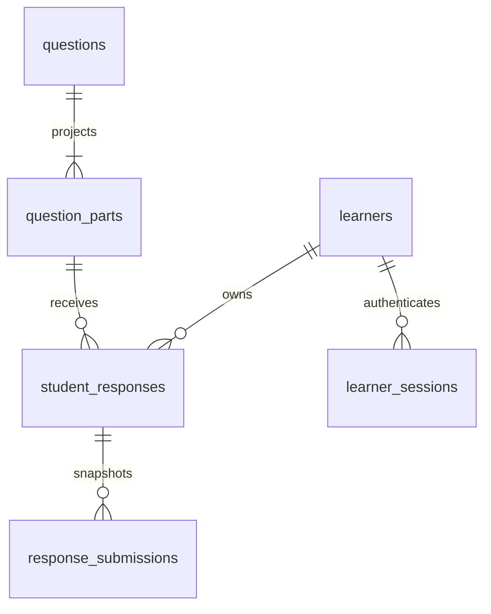

# Math Mate database schema

The SQL in [`supabase/migrations/`](../supabase/migrations/) is the schema source of truth. The initial migration creates the question bank; `20261016000000_learner_solutions.sql` adds guest learners, drafts, and submissions. Commit future schema changes as new migrations and update this document in the same change.

## Decision

Use **one `math_mate.questions` table for all curated questions**, regardless of topic or source paper. Each row has a stable ID and searchable metadata columns. `question_data jsonb` preserves the complete nested question, including parts, prompts, diagrams, responses, and mark schemes. `collection_data jsonb` preserves the source collection metadata. There is no table per topic or paper.

The current source bank is 32 files in `data/`, containing 181 questions. Those files remain the reviewed source material. `backend/scripts/import_questions.py` validates and upserts them by the question's existing `id`. Do not hand-edit a copy of a question in Supabase and leave its source JSON unchanged.

The `math_mate` schema is used server-side by `backend/app/main.py`. Do not expose it in Supabase's Data API or put database credentials in the React app. The full JSON includes mark schemes; the question-list API removes them and the mark-scheme endpoint serves them when requested.

## `math_mate.questions`

| Column | Type | Meaning / source |
| --- | --- | --- |
| `id` | `text` PK | Existing `questions[].id`; do not generate a new ID on import. |
| `collection_id` | `text` | `collection.id` from the source file. |
| `source_file` | `text` | Filename under `data/`, for traceability. |
| `topic_code` | `text` | Target bank topic from collection, question, or part alignment; the current bank is Topic `2`. |
| `subtopic_codes` | `text[]` | Distinct target subtopic codes from leaf parts, or from question alignment when no parts exist. A question may belong to multiple subtopics. |
| `question_number` | `integer` | `questions[].number` in the source paper. |
| `title` | `text` | `questions[].title`, when present. |
| `total_marks` | `integer` | `total_marks`, falling back to `marks`. |
| `difficulty_rank` | `smallint` | `difficulty.rank`, when present. |
| `paper_year` | `smallint` | `collection.source.year`. |
| `paper_session` | `text` | `collection.source.session`. |
| `paper_component` | `text` | `collection.source.component`; text preserves values such as `11` and `22`. |
| `calculator_allowed` | `boolean` | `collection.source.calculator_allowed`. |
| `question_data` | `jsonb` | Entire original `questions[]` object. |
| `collection_data` | `jsonb` | Entire original `collection` object. |
| `created_at`, `updated_at` | `timestamptz` | Import timestamps. An upsert should preserve `created_at` and refresh `updated_at`. |

`(collection_id, question_number)` is also unique, so one paper cannot accidentally import the same question number twice. The topic/year and subtopic indexes support the existing question-bank filters. The question JSON itself has no general index yet; add a targeted index only when a real query needs one.

Example filter:

```sql
select id, title, paper_year, paper_component, total_marks
from math_mate.questions
where topic_code = '2'
  and subtopic_codes @> array['2.2']::text[]
  and calculator_allowed = false
order by paper_year desc, question_number;
```

## Import and API rules

1. Read each `data/*.json` file and validate `collection.source` plus `questions` before writing.
2. Derive topic and subtopic codes using the fallback logic in `backend/scripts/import_questions.py`; some older papers use alignment on parts or question rather than `collection.syllabus.target_bank.topic_code`.
3. Upsert by `id`. Treat source JSON files as the reviewed content, and report duplicate IDs or conflicting `(collection_id, question_number)` values before import.
   Leaf part IDs must start with their question ID plus `-`; the solution endpoint uses this to fetch only the relevant question row.
4. Return question content through FastAPI. The list API strips mark schemes from every question part; `/api/v1/question-parts/{part_id}/solution` serves a selected answer and marking points.
5. Learner identities, sessions, drafts, and submissions live in separate tables, described below. Image uploads are described below. Tutor messages and AI are not implemented.

The API returns `localDraftOnly: false` and separate capabilities for saving, submitting, uploads, and AI. Saving and submitting are enabled; image uploads are enabled when server Storage credentials are configured. AI remains disabled. Browser storage is a recovery copy for pending work, not the database.

The migration was applied to Supabase and all 181 question rows were imported and verified on 15 October 2026. Re-run the importer after reviewing source JSON changes:

```powershell
.\.venv\Scripts\python.exe -m backend.scripts.import_questions
.\.venv\Scripts\python.exe -m backend.scripts.import_questions --apply
```

The first command validates without writing. The second upserts and verifies both full JSON objects for every imported question before committing. The importer does not delete rows whose source file was removed; review such deletions explicitly.

## Schema comparison and decision

Compared against `Alibaba Hackhaton/database/migrations/001_initial.sql` through `004_tutor_chat.sql`, plus its submission routes and repository. These are repository design findings, not load-test results.

| Concern | Hackathon app | Original Math Mate | Decision for this step |
| --- | --- | --- | --- |
| Curated content | Relational collections, questions, parts and marking points; JSON renderer blocks | One indexed question row with original nested JSON | Keep the reviewed JSON and existing question IDs. Fully splitting renderer content provides no demonstrated benefit for current queries. |
| Linking answers | Foreign key to a real question part | No learner storage | Add a minimal part identity projection and foreign keys. The database rejects orphan answers. |
| Ownership | Anonymous session UUID is also the access credential | Browser local storage | Stable learner UUID separate from an expiring secret token; hash the token at rest and send it only in Authorization headers. |
| Draft writes | One response per session and part with a revision counter | Browser local storage | One response per learner and part, with an expected revision to reject stale writes. Same-content retries do not increment revisions. |
| Submitted work | Mutable `ready_for_review` status; AI review tables hold later snapshots | None | Separate submitted snapshots now, without AI. Retrying a revision returns the same attempt. Later draft edits cannot rewrite its history through the API. |
| Images | `bytea` in database, also duplicated for reviews | Originally disabled | Separate compressed pages in private Supabase Storage; database metadata and immutable file references for submissions. No image bytes or merged copies in PostgreSQL. |
| Database connections | Bounded application pool | New connection per request | Reuse a bounded API pool; CLI imports and migrations retain direct connections. |
| Deployments | Migration ledger | First migration applied by importer | Add transactional, checksum-checked migration tracking and a read-only plan command. |

This is a hybrid design: relational identities, ownership, constraints and history, with JSON for flexible curated content and historical question snapshots. It preserves the existing importer instead of replacing a working question bank with the entire hackathon schema.



## Learner tables

All are in the private `math_mate` schema. UUIDs use PostgreSQL `gen_random_uuid()`; timestamps use `timestamptz`.

| Table | Key fields and guarantees |
| --- | --- |
| `question_parts` | Stable text `id`, `question_id` FK, `active`. An INSERT/UPDATE trigger projects leaf IDs recursively from `questions.question_data`. A question without parts gets `<question-id>-main`, matching the API. Removed parts remain inactive; IDs cannot move between questions. |
| `learners` | UUID `id`, `created_at`. Stable owner independent of sessions. Future account linking can attach to this identity without rewriting answer ownership. No account credentials are stored here. |
| `learner_sessions` | UUID `id`, `learner_id` FK, unique 64-character SHA-256 `token_hash`, creation and expiration timestamps. Server generates a 256-bit random token; default absolute lifetime is 90 days. Multiple credentials can eventually reference one learner. |
| `student_responses` | UUID `id`, `learner_id` FK, `question_part_id` FK, `typed_work` up to 20,000 characters, positive `revision`, timestamps. Unique `(learner_id, question_part_id)` gives exactly one current draft per part. |
| `response_submissions` | UUID `id`, `response_id` FK, `response_revision`, nonblank `typed_work`, student-safe `question_snapshot`, `submitted_at`. Unique `(response_id, response_revision)` makes submission retries idempotent. No update or deletion API is exposed. |
| `schema_migrations` | Filename version, SHA-256 checksum, applied timestamp. Prevents silently editing migrations already applied by the runner. |

Question and part foreign keys use RESTRICT where deleting curated content would orphan saved work. Learner deletion cascades through credentials, drafts, and submissions. Draft deletion cascades its attempts; no learner deletion endpoint is added in this step. Plan any future account deletion/retention policy explicitly.

Indexes cover part-to-question joins, learner session lookup and expiry, draft ownership and part lookup, and revision-ordered submission history. Draft and history APIs use bounded keyset pagination; loading a topic follows draft pages. There is no per-topic, per-student, or per-attempt table.

New learner tables enable RLS with no browser policies. The private schema and tables grant no access to `anon`, `authenticated`, or PUBLIC. The server currently connects as the configured privileged database role, which can bypass RLS; API ownership predicates are the enforced learner boundary. A future least-privileged runtime role must receive explicit grants and appropriate policies before it can use these tables. Do not expose the schema in Supabase's Data API.

## API and learner flow

1. `POST /api/v1/learner-sessions` creates a learner and credential atomically, returning a token and its expiry. The browser stores this credential separately from local draft text. No existing session UUID grants access to learner work.
2. All `/api/v1/me/*` endpoints require `Authorization: Bearer <token>`. The backend resolves the learner from the hash and expiry; the client does not choose an owner ID. Successful private responses use `Cache-Control: no-store`.
3. `GET /me/responses?topic_number=2&after=<part-id>&limit=100` restores drafts and whether each current revision has been submitted. `next_cursor` is null on the last page.
4. `PUT /me/responses/{part_id}` accepts `{ "typed_work": "...", "expected_revision": 0 }` for a new draft, or its last known revision for an edit. It locks the draft in a transaction, returns HTTP 409 for conflicting content, and increments the revision only when text changes. Ownership comes exclusively from the token.
5. The workspace writes a recovery copy on each edit and debounces server saves for 800 ms. It serializes saves for each part and clears the recovery copy only once the corresponding text is saved. Until restoration succeeds, editing and save buttons remain disabled. Differing local and server drafts require the learner to choose; stale writes are never silently retried over newer content.
6. `POST /me/responses/{part_id}/submissions` accepts `{ "expected_revision": 1 }`. The UI saves first, then submits that revision. The transaction validates nonblank work, snapshots its question and part without mark schemes, and stores the answer. Repeated requests for an existing revision return its existing submission, even after later edits. Autosaving never creates submissions. This is submission per answerable part, not a whole-paper hand-in.
7. `GET /me/responses/{part_id}/submissions?before=<revision>&limit=20` returns only that learner's attempts, newest first, with `next_cursor`. The workspace can show older submitted text while the learner edits the current draft.

Guests can resume in the same browser while the credential remains available and unexpired. Clearing browser data, using another device, or losing the credential prevents access; this phase has no login, account recovery or device sync. Credentials must travel over HTTPS in deployment. Expired/invalid credentials produce 401, without automatically replaying the request under a replacement identity. AI grading, chat, tutor services and scores remain unimplemented. The image migrations below extend this flow with separate compressed pages.

## Migrations, validation and deployment

Run from the project root with the existing server-only `.env`:

```powershell
.\.venv\Scripts\python.exe -m backend.scripts.migrate
.\.venv\Scripts\python.exe -m backend.scripts.migrate --apply
```

The first command plans without DDL or writes. The second takes a transaction advisory lock, adopts the initial question migration when its pre-existing table contract is present, then applies pending SQL and records checksums in the same transaction. A failure rolls everything back. The first adoption checks column availability, not a complete catalog equivalence proof; it is intended for this repository's previously imported database. Re-running an unchanged migration is a no-op. The initial importer still bootstraps the question table for compatibility; use the runner before starting learner-enabled API code.

After migration, the existing importer automatically maintains part identities through the database trigger and preserves learner work. Apply migrations once per deployment before starting the new API. The Render service uses `backend/` as its root, so run the command from the repository/deployment checkout where `supabase/migrations/` is available; migration files are not under Render's backend root. Do not rely on the API startup to apply DDL.

The API pool defaults to 1–5 connections per process, with a 10-second checkout timeout and at most 30 queued requests, using [Psycopg's connection pool](https://www.psycopg.org/psycopg3/docs/advanced/pool.html). Configure `MATH_MATE_DB_POOL_SIZE` with the total database connection budget in mind: replicas × workers × pool size, plus imports/migrations. This improves connection reuse; it is not proof of a particular concurrent-user capacity. Before a public production rollout, configure rate limits for guest creation and writes at the hosting edge, backups, and a guest-data retention policy. Account login and recovery remain a later step.

The learner migration was applied to the configured Supabase database on 16 October 2026. It preserved all 181 question rows and projected 396 active answerable parts. The pooled API health and question-bank smoke checks passed; integration-test learner records were rolled back.

Install development dependencies and run the integration tests explicitly:

```powershell
.\.venv\Scripts\python.exe -m pip install -r backend/requirements-dev.txt
$env:MATH_MATE_TEST_DB = '1'
.\.venv\Scripts\python.exe -m pytest backend/tests -q
```

Tests use transactions and savepoints that roll back test learner data (and temporarily validate the new migration when needed). They require a reachable configured Supabase database; without the environment opt-in they skip. Frontend checks: `npm test`, `npm run test:questions`, `npm run test:voice`, and `npm run build` in `frontend/`.


## Separate compressed solution pages

The image feature adds `20261016010000_solution_images.sql` and the reverse-lookup index in `20261016020000_attachment_file_lookup.sql`. The chosen storage service is **Supabase Storage on the existing free project**, with a private `math-mate-solutions` bucket. No plan upgrade is required for the implementation; usage still counts toward the project's available allowance. See [Supabase pricing](https://supabase.com/pricing).

Each question-part response can hold **up to four uploaded pages**, in upload order. Typed work retains its separate 20,000-character limit. The server stores one compressed JPEG per page. It does not retain the original uploaded binary, create a merged image, or call an AI service. The stored pages provide the ordered source material for a future AI pipeline to merge or send separately according to the selected model.

### Compression and file validation

- Accept JPEG, PNG and WebP still images, at most 10 MiB per input and 25 megapixels decoded; require at least 64 pixels on each side. Validate decoded file contents rather than trusting MIME headers or filenames. Reject animation, corrupt files and excessive decoded dimensions.
- Correct EXIF orientation, flatten transparency onto white, keep the aspect ratio, and resize only when the longest edge exceeds 2,200 pixels. Re-encode as JPEG and strip EXIF/GPS/embedded metadata. [Pillow's EXIF transpose documentation](https://pillow.readthedocs.io/en/stable/reference/ImageOps.html#PIL.ImageOps.exif_transpose) describes orientation handling.
- Start at JPEG quality 88, then try 82 and 76 only if output exceeds a soft 1 MiB target. Use full chroma resolution for colored writing. Do not repeatedly shrink the page or lower quality indefinitely just to meet a tiny KB target. Stored objects cannot exceed 5 MiB. A small source may already be more compact than its normalized JPEG; no fixed compression ratio is promised.
- Bound the multipart request body to 10 MiB plus 64 KiB of form overhead, including streamed requests. Limit image decoding to one operation at a time per API process to bound peak memory on the current small hosting instance. A busy decoder returns a retryable 503; this is not a durable image-processing queue or a load-tested throughput claim.

### Image tables and ownership

| Table | Purpose and constraints |
| --- | --- |
| `solution_files` | UUID `id`, `response_id`, private `bucket`/`object_key`, source and compressed SHA-256 hashes, original/stored byte sizes, compressed dimensions, media type, encoder version, state and timestamps. No binary data. Unique `(response_id, upload_sha256)` reuses the same stored page when the identical file is retried or reattached. |
| `response_attachments` | UUID draft attachment identity, `response_id`, `file_id`, original display filename, `position` in 1?4, and optional `removed_at`. Partial unique indexes on active slots and active files enforce the four-page limit and prevent duplicate active pages, including concurrent requests. Removing a page retires its draft link; remaining pages are renumbered in one transaction. |
| `submission_attachments` | Ordered snapshot of `submission_id`, `response_id`, `file_id`, position and display filename. Composite foreign keys ensure files and submissions belong to the same response. A page cannot be physically deleted while a submitted attempt references it. Attempts share existing immutable files instead of copying the same image for every text edit. |

All three tables use RLS with no browser policies and revoke browser/public access, like the other learner tables. The backend resolves learner ownership from the guest bearer token before issuing a viewing link. The bucket is private; links expire after 15 minutes and are generated on demand, not persisted in database rows. Possession of a signed viewing link grants temporary file access, so do not log or publish it. See [Supabase private bucket access](https://supabase.com/docs/guides/storage/buckets/fundamentals).

Adding or removing a page increments the response revision and clears its current-submission status by advancing that revision. Text autosave returns all current attachments and never removes them. Submission snapshots text and ordered file references together under the same response lock. Submissions can contain text, images, or both; a deferred database constraint checks that an empty-text submission has at least one image reference by transaction completion. Existing text-only submissions remain valid. Draft changes leave submitted pages intact.

### Upload API and recovery

- `POST /api/v1/me/responses/{part_id}/attachments`: multipart `image` and `expected_revision` after creating/restoring the draft. The browser validates page count and size, then uploads each selected page individually with the revision returned by the previous operation. The server enforces all limits again. A duplicate active file returns the current response without creating a second page or incrementing its revision.
- `DELETE /api/v1/me/responses/{part_id}/attachments/{attachment_id}?expected_revision=...`: remove only that learner's draft link, returning the new revision and ordered pages. Retrying removal of an already retired link is a no-op.
- `GET /api/v1/me/solution-files/{file_id}/url`: validate ownership, verify that the bucket remains private, then return a short-lived signed URL. The browser downloads the compressed image directly from Storage, avoiding an image-byte proxy through FastAPI.
- The existing response and submission list APIs include ordered page metadata, but not credentials, object bytes or permanent viewing URLs. The workspace supports image-only submission, page previews, removal, page labels and viewing historical pages. AI controls remain disabled.
- `GET /me/responses/{part_id}` returns one authenticated learner's draft with its revision and ordered active pages, holding a shared response-row lock for a consistent retry check. Missing drafts and other learners' drafts return 404. Draft page metadata includes the original-file `upload_sha256` checksum to identify a saved photo after a lost confirmation. Checksums and responses remain private with `Cache-Control: no-store`; they do not grant Storage access.

File uploads are not atomic with PostgreSQL transactions. The server first commits a `pending` file intent with its generated key, uploads to Storage without holding a database connection or response lock, then locks/rechecks the response revision and attaches the ready file. It only reports success after the final database transaction commits. If Storage fails or the draft changes during upload, typed work and previously attached pages stay intact; the registered intent is retryable.

The workspace keeps a per-answer photo queue. Each photo shows browser-to-API transfer progress, followed by an indeterminate saving state until the server confirms the committed response. A 100% transfer is not a completed save; see [XMLHttpRequest upload events](https://developer.mozilla.org/en-US/docs/Web/API/XMLHttpRequest/upload). Requests time out after 120 seconds. A batch stops on failure, retains its failed/waiting originals in memory, and leaves successful pages saved. Students can retry a failed photo or all remaining photos without selecting them again, or remove a known failed/waiting photo. Permanent validation failures require removal and a replacement file. Unfinished photos reserve slots toward the four-page limit and prevent submission until resolved.

Network errors, timeouts, malformed success responses and server errors can leave the commit outcome uncertain. The client checks the authenticated draft for the original-file checksum before treating such a photo as failed or retransmitting it on retry. Server deduplication remains authoritative if browser hashing is unavailable or the first request is still finishing. Retry checks use the existing serialized revision/conflict safeguards. No automatic upload loop runs, and an uncertain photo cannot be discarded until its saved state is checked through Retry.

Selected originals and preview URLs exist only while the practice workspace remains open; they are not persisted in browser storage. A browser leave/reload prompt warns about unfinished photos, and unmount aborts active browser requests, stops waiting requests and releases previews. After reopening, successful pages restore from the API, while unfinished originals must be selected again. This is a whole-photo retry, without resumable byte chunks. No database migration or additional environment setting is needed for upload progress and retries.

The client serializes text and page mutations for each part. Page operations temporarily disable that part's editor and buttons. Revision conflicts require a learner choice. If an idempotent page response includes text changed by another tab, the client surfaces that conflict instead of silently adopting its revision and later overwriting the text.

### Setup and cleanup

The root server-only `.env` needs these additional values:

```dotenv
SUPABASE_URL=https://<project-ref>.supabase.co
SUPABASE_SECRET_KEY=<server secret API key>
MATH_MATE_STORAGE_BUCKET=math-mate-solutions
```

The bucket name has the shown default. Legacy `SUPABASE_SERVICE_ROLE_KEY` can replace `SUPABASE_SECRET_KEY`; publishable keys and `SUPABASE_JWKS_URL` are not used by this guest upload flow. New `sb_secret_` keys are sent only in the `apikey` header; legacy service-role JWTs also use Authorization. Never put either server key in frontend variables. See [Supabase API keys](https://supabase.com/docs/guides/getting-started/api-keys).

```powershell
.\.venv\Scripts\python.exe -m pip install -r backend/requirements.txt
.\.venv\Scripts\python.exe -m backend.scripts.migrate --apply
.\.venv\Scripts\python.exe -m backend.scripts.setup_storage --apply
```

Bucket creation uses the Storage API and sets private access, JPEG-only stored objects and a 5 MiB stored-file limit. The SQL migrations only change app-owned schema. Add the same URL and server secret to the deployed backend environment (Render), then restart/redeploy the API; no frontend Storage secret or signed-in Supabase browser client is required.

Abandoned upload intents and removed **unsubmitted** pages become eligible for cleanup after 24 hours without use. Active draft pages and all submitted pages are retained. Cleanup runs only when invoked; arrange a scheduled invocation in deployment if desired:

```powershell
.\.venv\Scripts\python.exe -m backend.scripts.cleanup_storage
.\.venv\Scripts\python.exe -m backend.scripts.cleanup_storage --apply
```

The first command only reports eligible file count. The second processes at most 100 eligible files per invocation, locks and rechecks references, commits a `deleting` intent, deletes the Storage object, then removes metadata. A failed Storage deletion leaves its intent for the next run. Do not manually delete file metadata, learner rows, or bucket objects to free space: that bypasses reference tracking and the object lifecycle. Future account deletion must enqueue object cleanup before removing learner records. Database backups do not include Storage file contents; production file backup and retention policies are separate from database backup.

Image unit tests cover decoding, EXIF rotation, transparency, repeatability, size reduction and invalid files; Storage adapter tests cover private buckets, secret headers, temporary links, transport errors and request-body limits. Database tests use a fake object store and roll back records, testing four-page enforcement, isolated access, duplicates, image-only submissions, revision conflicts, failed upload retry and reference-aware cleanup. Frontend tests exercise ordered separate uploads, image-only submission, removal, history and partial failures. No OCR accuracy or future AI token cost is claimed.

The image migrations and private bucket were applied on 16 October 2026. A live Storage upload and signed download returned identical compressed bytes; the temporary verification object was removed. The sample page compressed from 437,816 to 161,861 bytes at 1,650 × 2,200 pixels. This is a test-page result, not a guaranteed compression ratio for student photos. The nine rollback-only database integration tests, eight image/Storage unit tests, frontend suites and production build passed.
